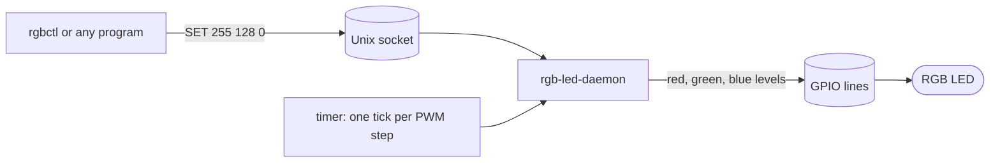

# linux-rgb-led-daemon

[](https://github.com/PATEmbedded/linux-rgb-led-daemon/actions/workflows/ci.yml)
[](LICENSE)

Drives one RGB status LED from three GPIO lines on Linux, using software PWM. Other programs choose the colour through a local Unix socket with a one-line text protocol. It runs as a systemd service.

Use it when a board has no spare hardware PWM output for the LED and a few colours with dimming are enough for a status indicator.

## How it works



- **Software PWM** with 256 steps per period. A channel at level L is lit for L steps of each period, so its brightness is L/256 of full power. Brightness is linear: no gamma correction is applied.
- **One step per tick.** The step length is set with `--step-us` (default 50 µs). These values follow from the settings and have **not been measured on hardware yet**:
  - one period = 256 × 50 µs = 12.8 ms, about 78 Hz
  - the daemon wakes up 20,000 times per second
- **Writes only on change.** The GPIO lines are written only when a channel changes, so a steady colour costs no writes.
- **One thread.** A single epoll loop handles the timer, the client connections and the termination signals. No locks are needed.

## Hardware

- Give each channel its own current-limiting resistor. Check the LED datasheet and the maximum current of the GPIO pins.
- For a common-anode LED (it lights when its line is low), start the daemon with `--active-low`.
- Find the line offsets of your board with `gpioinfo` from libgpiod. Each channel needs a different line.

## Build and install

Requirements: Linux, CMake 3.16 or newer, a C++17 compiler, and `libgpiod` 2.0 or newer with its development files (`libgpiod-dev`). Debian 13 (trixie) and Ubuntu 25.10 or newer ship libgpiod 2.x. Ubuntu 24.04 and older Debian releases ship libgpiod 1.6, which is not supported. Check the version with `pkg-config --modversion libgpiod`.

```sh
cmake -S . -B build -DCMAKE_BUILD_TYPE=Release -DCMAKE_INSTALL_PREFIX=/usr
cmake --build build
sudo cmake --install build
```

## Run as a service

1. Set the line offsets for your wiring. The unit file has placeholder values:

   ```sh
   sudo systemctl edit rgb-led-daemon
   ```

   Then add an `ExecStart=` line with your offsets. The first empty `ExecStart=` clears the default.

2. Create the `rgbled` system user, then start the service:

   ```sh
   sudo systemd-sysusers
   sudo systemctl enable --now rgb-led-daemon
   ```

3. Let a user send commands by adding them to the `rgbled` group:

   ```sh
   sudo usermod -aG rgbled <user>
   ```

## Use

```sh
rgbctl set 255 128 0    # orange
rgbctl status           # prints: OK 255 128 0
rgbctl off
```

Any program can speak the protocol. Connect to the socket (default `/run/rgb-led/rgb-led.sock`) and send one command per line:

| Command | Reply | Meaning |
|---|---|---|
| `SET r g b` | `OK` | show a colour; each level is 0 to 255 |
| `OFF` | `OK` | show black |
| `STATUS` | `OK r g b` | the colour that is set |
| `PING` | `OK` | the daemon is running |
| anything else | `ERR <reason>` | the command was rejected |

Keywords are case-insensitive and fields are separated by spaces or tabs. A line is at most 64 characters.

## Daemon options

| Option | Default | Meaning |
|---|---|---|
| `--red`, `--green`, `--blue` | required | GPIO line offsets of the channels |
| `--chip` | `/dev/gpiochip0` | GPIO character device |
| `--active-low` | off | the LED lights when its line is low |
| `--socket` | `/run/rgb-led/rgb-led.sock` | command socket |
| `--step-us` | `50` | PWM step length, 10 to 1000 µs |

## Security

- The daemon runs as the dedicated `rgbled` user with no capabilities. It can write only to its runtime directory and to the GPIO lines.
- The socket is mode `0660` inside a `0750` directory owned by `rgbled`. Only members of that group can send commands.
- The socket accepts only the commands in the table above. Lines are length-limited, and a client that sends an oversized line is disconnected.
- The unit file applies `ProtectSystem=strict`, `NoNewPrivileges`, `RestrictAddressFamilies=AF_UNIX` and related hardening.

## Limits

- Software PWM depends on the kernel timer. Timing jitter, CPU use and visible flicker have **not been measured**. Check them on the target board before relying on the defaults, and use a longer `--step-us` if the CPU load is too high.
- Only the GPIO character device of libgpiod 2.x is supported. The older sysfs interface is not.
- The protocol has no authentication beyond the socket permissions.

## Layout

```
src/rgb/          PWM, colour model, protocol parser and controller (no OS dependency)
src/gpiod/        libgpiod backend of the lamp output
src/ipc/          Unix socket helpers
src/daemon/       rgb-led-daemon: options, epoll loop, signals
src/rgbctl/       rgbctl: command-line client
test/             unit tests (GoogleTest)
packaging/        systemd unit and sysusers.d entry
```

## Tests

The unit tests cover the PWM duty cycle, channel independence, the protocol parser and the controller's write behaviour. They run on a PC with sanitizers. CI also builds the daemon and client on Ubuntu with libgpiod and runs smoke tests.

```sh
cmake -S . -B build -DRGB_LED_BUILD_DAEMON=OFF -DRGB_LED_SANITIZE=ON
cmake --build build
ctest --test-dir build --output-on-failure
```

## License

MIT. See [LICENSE](LICENSE).
